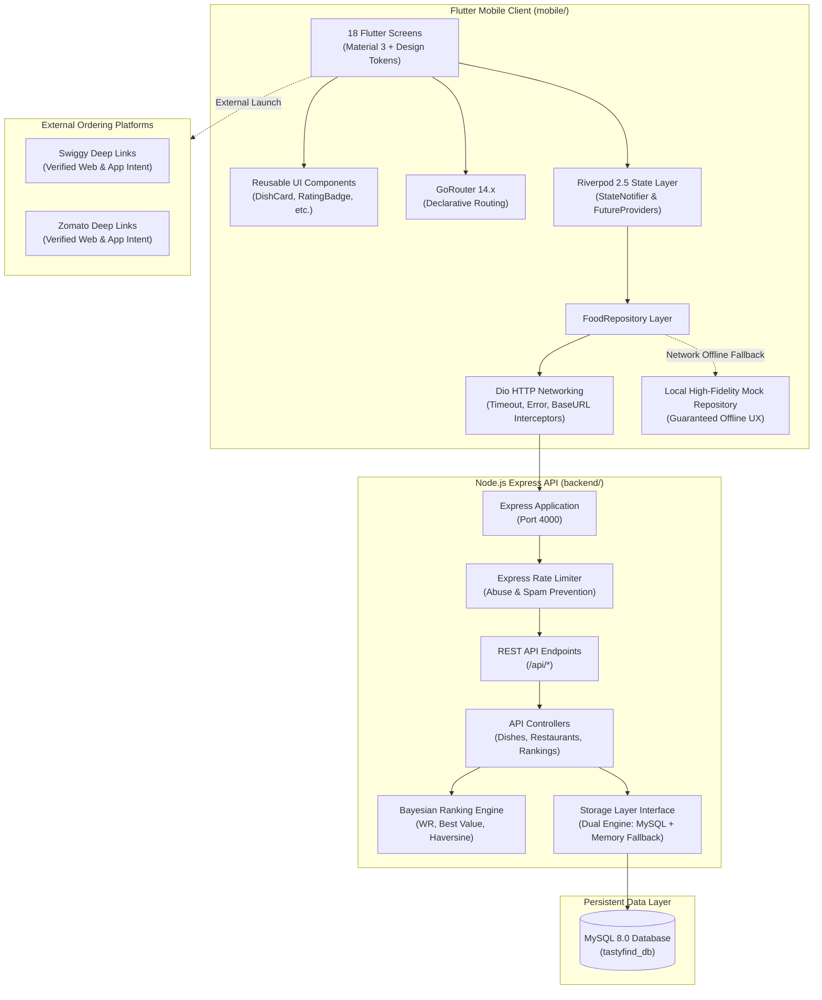

# TastyFind Architecture & Technical Design

## 1. Executive Summary

**TastyFind** is a dish-first mobile food discovery platform designed to help food lovers discover the single best-tasting dishes in their town (e.g. the highest-rated Dosa, Biryani, or Parotta), compare verified prices, read dish-specific customer reviews, and order seamlessly via official Swiggy and Zomato integrations.

Unlike conventional food apps that aggregate ratings exclusively at the restaurant level, TastyFind ranks **individual dishes** using a mathematical **Bayesian Weighted Rating algorithm** and an affordability-adjusted **Best-Value index**.

---

## 2. System Architecture

The TastyFind ecosystem is split into two cleanly separated subsystems:
1. **Mobile Application (`mobile/`)**: Cross-platform Flutter client with Riverpod state management, GoRouter navigation, Dio HTTP layer, and local fallback offline caching.
2. **Backend REST API (`backend/`)**: Node.js & Express API with a MySQL 8.0 relational schema, database migrations, seed scripts, rate limiting, and an automatic in-memory storage fallback.

---

## 3. Flutter Application Architecture

### Clean Architecture Layers
1. **Presentation Layer (`lib/screens/`, `lib/widgets/`)**:
   - 18 focused screens covering onboarding, geolocation, dish rankings, restaurant details, menu exploration, multi-criteria filtering, order redirection, wishlist, user reviews, notifications, and settings.
   - Reusable visual primitives: `DishCard`, `RestaurantCard`, `RatingBadge`, `PriceTag`, `SearchBarWidget`, `CategoryChipWidget`, and `FeedbackWidgets`.
2. **State Management Layer (`lib/providers/`)**:
   - Powered by Riverpod (`flutter_riverpod`).
   - Unidirectional data flow with explicit state containers (`FilterNotifier`, `SavedNotifier`).
   - Fine-grained reactivity using `FutureProvider.family` for parameterized dish and restaurant queries.
3. **Data Layer (`lib/data/`, `lib/models/`)**:
   - `ApiClient`: Dio-based networking with environment-aware endpoints (Android emulator `10.0.2.2`, Web/Desktop/iOS `localhost`).
   - `FoodRepository` interface: Decouples UI from networking protocols.
   - `MockData`: Comprehensive sample dataset containing authentic Erode restaurants, dishes, and verified links.

---

## 4. Backend Service Architecture

### Modular Node.js / Express Design
- **RESTful Endpoints**: Predictable HTTP verbs and JSON payloads.
- **Unified Storage Engine (`src/db/storage.js`)**: Automatically detects whether MySQL is available. If MySQL credentials are provided and the daemon is online, it connects via `mysql2/promise`. If offline, it initializes the identical relational dataset in memory, ensuring non-blocking local development.
- **Ranking Engine (`src/services/rankingService.js`)**: Pure, testable computational functions for Bayesian rating calculations, Best-Value scores, and Haversine spatial distances.
- **Security & Integrity**:
  - Request rate limiting on review submissions (`express-rate-limit`).
  - Parameterized database operations preventing SQL injection.
  - Review moderation status (`pending`, `approved`, `rejected`) preventing malicious manipulation of public ratings.
  - Price verification timestamps (`price_verified_at`) preventing misleading pricing claims.
